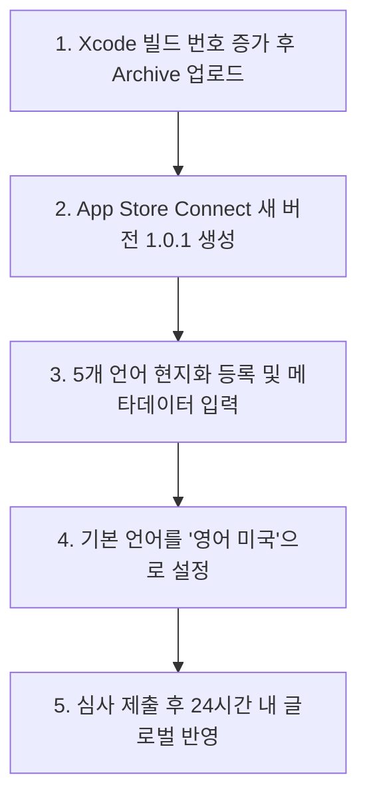

# 05. 5개국어 글로벌 검색 최적화(ASO) 및 앱 버전 업데이트(1.0.1) 가이드

미국, 일본, 중국, 대만/홍콩 등 전 세계 사용자가 **자국어(영어, 일본어, 중국어) 및 브랜드명(`OneDay Trip`, `Korea travel`, `韓国旅行` 등)으로 검색했을 때 앱이 1순위로 노출**되도록 하는 5개국어 ASO(App Store Optimization) 등록 및 1.0.1 버전 업데이트 가이드입니다.

---

## 📌 1. 핵심 원리: 애플 앱스토어 검색 인덱싱 구조

애플 앱스토어 검색 엔진은 **오직 아래 3가지 필드에 등록된 단어만 검색**합니다.  
*(※ 상세 설명(Description) 본문은 검색에 반영되지 않습니다)*

```text
[1순위] 앱 이름 (App Name - 최대 30자)        ➔ 검색 가중치 가장 높음
[2순위] 부제 (Subtitle - 최대 30자)          ➔ 검색 가중치 2위
[3순위] 키워드 (Keywords - 최대 100자 숨김 필드)➔ 콤마(,) 구분 인덱싱
```

### 💡 5개국어 검색 지원 전략 (대한민국 전역 여행 포괄)
1. **한국어 (Korean)**: 국내 사용자의 `하루여행`, `당일치기`, `한국여행`, `전국여행`, `맛집` 등 검색 노출
2. **영어(미국) (English - U.S.)**: 미국 및 글로벌 사용자의 `OneDay Trip`, `Korea travel`, `Korea map`, `Day trip` 검색 노출 + **기본 언어(Primary Language)**로 지정하여 미등록 국가에 영어로 자동 Fallback
3. **일본어 (Japanese)**: 일본 사용자의 `ワンデイトリップ`, `韓国旅行`, `韓国グルメ`, `日帰り` 검색 노출
4. **중국어 간체 (Chinese Simplified)**: 중국 본토 사용자의 `OneDay Trip`, `韩国旅游`, `一日游`, `韩国美食` 검색 노출
5. **중국어 번체 (Chinese Traditional)**: 대만, 홍콩 사용자의 `韓國旅遊`, `一日遊`, `行程規劃`, `韓國自由行` 검색 노출

---

## 🚀 2. 전체 작업 절차 (App Store Connect 1.0.1 버전)



### 1단계: Xcode 프로젝트 빌드 번호 올리기
1. Xcode 프로젝트 설정 ➔ **General** ➔ **Identity**:
   * **Version**: `1.0.1`
   * **Build**: `1` (또는 기존 빌드 번호 +1)
2. 타겟을 **Any iOS Device (arm64)**로 설정 ➔ **Product ➔ Archive**
3. **Distribute App**으로 App Store Connect에 업로드

### 2단계: App Store Connect 신규 버전 생성
1. [App Store Connect](https://appstoreconnect.apple.com) 접속 ➔ **[나의 앱]** ➔ **[하루여행]**
2. 좌측 iOS 앱 메뉴의 **[+] 버전 또는 플랫폼** 클릭 ➔ 버전 `1.0.1` 입력 후 생성

### 3단계: 5개 언어 메타데이터 입력
버전 상세 페이지 우측 상단의 언어 선택 드롭다운에서 **[언어 추가]**를 클릭하여 아래 4개 언어를 순서대로 추가하고, [스토어_등록정보_복사용.md](스토어_애셋/스토어_등록정보_복사용.md)의 내용을 붙여넣습니다:
* `영어(미국) - English (U.S.)`
* `일본어 - Japanese`
* `중국어(간체) - Chinese (Simplified)`
* `중국어(번체) - Chinese (Traditional)`
*(한국어는 기존 데이터가 자동 유지됩니다)*

### 4단계: 기본 언어(Primary Language)를 '영어(미국)'로 지정
1. 좌측 메뉴 **[일반 정보] ➔ [앱 정보]** 클릭
2. **[기본 언어]** 드롭다운에서 **`영어(미국) - English (U.S.)`** 선택 후 저장
   *(한국 사용자에게는 한국어가 그대로 노출되고, 그 외 전 세계 사용자는 영어로 기본 노출됩니다)*

### 5단계: 빌드 선택 및 심사 제출
1. `1.0.1 준비 중` 페이지에서 업로드 완료된 빌드를 선택
2. **심사 메모 (Review Notes)** 입력:
   ```text
   This update adds full 5-language localization (Korean, English US, Japanese, Simplified Chinese, Traditional Chinese) to support global travelers visiting South Korea. App functionality and flows remain identical to the approved version.
   ```
3. **[심사에 추가] ➔ [심사 제출]** 클릭

---

## 📋 3. 5개국어 검색 최적화(ASO) 메타데이터 요약

*(모든 필드는 30자 / 100자 / 170자 글자 수 제한을 철저히 검증 완료했습니다)*

| 언어 | 앱 이름 (최대 30자) | 부제 (최대 30자) | 핵심 검색어 (키워드 100자) |
| :--- | :--- | :--- | :--- |
| **🇰🇷 한국어** | `하루여행 - 당일치기 여행 코스 지도` | `한국 여행 명소·로컬 맛집 코스 추천` | `하루여행,한국여행,당일치기,전국여행,맛집,지도,가볼만한곳,데이트코스,카페,코스추천,일정,동선최적화,네이버지도,국내여행,내주변,핫플레이스,주말여행,여행플래너,숨은맛집,길찾기,관광지,로컬맛집` |
| **🇺🇸 영어(미국)** | `OneDay Trip - Korea Travel Map` | `Korea Day Trip & Local Guide` | `oneday,trip,korea,travel,korean,food,map,daytrip,itinerary,route,planner,tour,guide,tourist,spot,visit` |
| **🇯🇵 일본어** | `ワンデイトリップ - 韓国旅行マップ` | `韓国日帰り旅行・ローカルグルメガイド` | `oneday,trip,韓国,旅行,グルメ,マップ,日帰り,コース,おすすめ,カフェ,道案内,観光,旅,全国,人気,ガイド` |
| **🇨🇳 중국어(간체)** | `OneDay Trip - 韩国旅游地图` | `韩国一日游路线规划与美食地图` | `oneday,trip,韩国,旅游,美食,地图,一日游,路线,攻略,行程,咖啡厅,导航,景点,打卡,自由行,全国` |
| **🇭🇰/🇹🇼 중국어(번체)** | `OneDay Trip - 韓國旅遊地圖` | `韓國一日遊行程規劃與美食地圖` | `oneday,trip,韓國,旅遊,美食,地圖,一日遊,路線,攻略,行程,咖啡廳,導航,景點,打卡,自由行,全國` |

> 📌 **상세 설명(Description) 및 프로모션 텍스트 전체 전문**은  
> [등록과정/스토어_애셋/스토어_등록정보_복사용.md](스토어_애셋/스토어_등록정보_복사용.md)에서 각 언어별로 즉시 복사하여 사용하실 수 있습니다.
